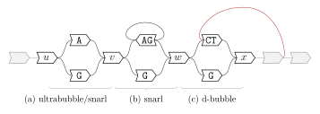

# BubbleFinder

[](https://github.com/algbio/BubbleFinder/actions/workflows/bruteforce.yml)
[](https://anaconda.org/bioconda/bubblefinder)
[](https://github.com/algbio/BubbleFinder/releases/latest)
[](https://opensource.org/licenses/)
[](https://opensource.org/)

**BubbleFinder** identifies potential sites of genetic variation in pangenome graphs. In these graphs, nodes represent DNA sequences and links connect them. For example, the paths in region (a) share the same flanking sequences, `u` and `v`, and differ only at one base: A or G.

<p align="center">
  
</p>

Arrow-shaped nodes show sequence orientation. A path can follow links in either direction, but must leave each node through the opposite end from which it entered.

For genome and pangenome graphs in GFA or GBZ format, BubbleFinder can:

- Find **superbubbles** ([Onodera et al., 2013](#ref-onodera2013)), **snarls** and **ultrabubbles** ([Paten et al., 2017](#ref-paten2017)) efficiently using algorithms we developed.
- Find **d-bubbles**, a type of variation site we defined using dominator trees ([Sena et al., forthcoming](#ref-dominator-bubbles)).
- Export ultrabubble nesting hierarchies and SPQR-tree decompositions.

### Choosing a bubble type

| Command | Regions to look for |
|---|---|
| `ultrabubbles` | Regions without loops or branches ending inside them (a). |
| `snarls` | Regions that also allow loops or branches ending inside them (b). |
| `d-bubbles` | Regions that allow links between internal nodes and nodes outside their boundaries (c). See [details](docs/d-bubbles.md). |
| `superbubbles` | Regions with one entrance, one exit and no internal loops in a directed sequence graph. |

See [Quickstart](#quickstart) for installation and an example.

The commands `snarls`, `superbubbles` and `ultrabubbles --spqr-weak-superbubbles` use a unified SPQR-tree framework ([Sena et al., 2026](#ref-sena2026)) built with our [SPQR-Rust](https://github.com/algbio/spqr-rust) library. SPQR trees split the pangenome graph into smaller parts, making bubbles easier to find ([Di Battista and Tamassia, 1990](#ref-dibattista1990)).

BubbleFinder has been tested on real and synthetic graphs (see [Validation](../../wiki/Validation), [Sena et al., 2026](#ref-sena2026) and [Harviainen et al., 2026](#ref-harviainen2026)). The papers also provide correctness proofs for the algorithms.

---

## Table of Contents

- [Quickstart](#quickstart)
- [Algorithms](#algorithms)
- [Commands overview](#commands-overview)
- [Running BubbleFinder](#running-bubblefinder)
  - [Input data](#input-data)
  - [Command-line options](#command-line-options)
- [Output format](#output-format)
- [References](#references)

**Additional resources (Wiki):**
- [Flowchart](../../wiki/Flowchart), which details execution paths for all commands
- [Internals](../../wiki/Internals), covering graph representation, optimization notes, and theoretical background
- [Validation](../../wiki/Validation), describing bruteforce testing and the random test harness

---

## Quickstart

### Prebuilt Linux binary

Download the latest release:

https://github.com/algbio/BubbleFinder/releases/latest

```bash
./BubbleFinder --version
./BubbleFinder --help
./BubbleFinder snarls -g example/tiny1.gfa -o tiny1.snarls
```

### Conda / Bioconda

```bash
conda create -n bubblefinder_env -c conda-forge -c bioconda bubblefinder
conda activate bubblefinder_env
./BubbleFinder --help
```

### Build from source (Linux)

```bash
git clone --recurse-submodules https://github.com/algbio/BubbleFinder && \
cd BubbleFinder && \
cmake -S . -B build && \
cmake --build build -j <NUM_THREADS> && \
mv build/BubbleFinder .
```

Replace `<NUM_THREADS>` with the number of parallel build jobs (e.g. `-j 8`). Omitting `-j` builds single-threaded.

**Dependencies** are handled automatically by the build system:
- SPQR-Rust is built automatically with Cargo. A Rust toolchain must be installed.
- [zstd](https://github.com/facebook/zstd) is detected on the system. If not found, it is fetched and built from source.
- [OpenSSL](https://www.openssl.org/) (`libcrypto`) must be available on the system.
- OpenMP is optional. When found, it enables intra-block parallelism.
- GBZ support pulls in four submodules, all under `external/gbz/` and built automatically:
  - [gbwtgraph](https://github.com/jltsiren/gbwtgraph) is the GBZ/GBWTGraph library
  - [gbwt](https://github.com/jltsiren/gbwt) is the GBWT index
  - [sdsl-lite](https://github.com/vgteam/sdsl-lite) provides low-level data structures
  - [libhandlegraph](https://github.com/vgteam/libhandlegraph) is the handle graph interface

### First analysis

```bash
./BubbleFinder ultrabubbles -g graph.gfa -o ultrabubbles.txt
```

The result lists the boundary node IDs of each region. See [Output format](#output-format) for details.

---

## Algorithms

### Unified SPQR-tree framework

The theoretical linear-time bounds (`O(|V|+|E|)`) for this framework are described in [Sena et al., 2026](#ref-sena2026).

> [!IMPORTANT]
> `snarls` computes **all** snarls and aims to replicate the behavior of [`vg snarls -a -T`](https://github.com/vgteam/vg), **but** `vg` outputs only a pruned, linear-size *snarl decomposition*.\
> Therefore, `BubbleFinder` may output **more** snarls than `vg snarls`.

### Ultrabubble methods

The default method worked on all pangenome graphs we tested. We did not observe any of the [special cases](#ultrabubble-special-cases) described below. The default method and `--d-bubbles` are generally the fastest options.

| Option | Method |
|---|---|
| No method flag (default) | Uses graph orientation. |
| `--doubled` | Uses a doubled graph and more RAM. |
| `--spqr-weak-superbubbles` | Uses the [SPQR method](#unified-spqr-tree-framework). |
| `--d-bubbles` | Finds ultrabubbles using dominator trees. See [which regions are searched](docs/d-bubbles.md). |

The method flags cannot (of course) be combined.

Output options:

- `-T` / `--include-trivial`: include trivial ultrabubbles.
- `--clsd-trees <file>`: export the nesting hierarchy, in default or `--doubled` mode only.
- `--compact-output-chains`: compact compatible endpoint pairs into chains. See [Output format](#output-format).

`--d-bubbles` cannot be combined with `--clsd-trees` or `--compact-output-chains`. See [Command-line options](#command-line-options) for shared flags such as `-g`, `-o` and `-j`.

> [!NOTE]
> The default orientation-based method runs in `O(|V|+|E|)` time. Its correctness proof and benchmarks are described in [Harviainen et al., 2026](#ref-harviainen2026).

<a id="ultrabubble-special-cases"></a>
<details>
<summary>Special cases</summary>

For GFA/GBZ files, the default method needs each connected part of the graph to have an end (a **tip**, often a chromosome end) or a point whose removal separates the graph into several parts (a **cut vertex**).

For parts with neither, prefer the [SPQR method](#ref-sena2026). The current `--spqr-weak-superbubbles` option does not yet support this case.

</details>

### D-bubbles via dominator trees

This method needs at least two ends (**tips**) of the graph.

D-bubbles use reciprocal immediate dominators in the augmented doubled graph. The implementation uses the Lengauer--Tarjan algorithm with `O((|V|+|E|) log(|V|+|E|))` worst-case time. See [the definition and coverage](docs/d-bubbles.md).

> [!NOTE]
> The definition, proofs, and benchmarks are described in [Sena et al., preprint forthcoming](#ref-dominator-bubbles).

---

## Commands overview

| Command | Typical input | Output endpoints | Notes |
|---|---|---|---|
| `snarls` | bidirected GFA / GBZ | oriented incidences (`a+`, `d-`) | uses compressed SPQR path and may output cliques |
| `superbubbles` | bidirected GFA / GBZ (default) or directed (`--directed`) | segment IDs (`a`, `e`) in bidirected mode, oriented IDs (`a+`, `e-`) in directed mode | see [superbubble input convention](#directed-mode-for-superbubbles) |
| `ultrabubbles` | bidirected GFA / GBZ | oriented incidences | four methods. See [Ultrabubble methods](#ultrabubble-methods) |
| `spqr-tree` | GFA / GBZ only | `.spqr` v0.4 | connected components + BC-tree + SPQR decomposition |
| `d-bubbles` | bidirected GFA / GBZ | oriented incidences | d-bubbles |

The bubble commands exclude trivial bubbles by default. Use `-T` to include them.

For a detailed walkthrough of all execution paths, see the [Flowchart](../../wiki/Flowchart) on the Wiki.

---

## Running BubbleFinder

```text
./BubbleFinder <command> -g <graphFile> -o <outputFile> [options]
```

Available commands:
- `superbubbles` find superbubbles (bidirected by default, use `--directed` for directed mode)
- `snarls` find snarls (bidirected GFA or GBZ, compressed SPQR path)
- `ultrabubbles` find ultrabubbles (see [Ultrabubble methods](#ultrabubble-methods) for all methods and output options)
- `spqr-tree` output the connected components, BC-tree and SPQR decomposition in `.spqr` v0.4 format
- `d-bubbles` find d-bubbles (see [docs/d-bubbles.md](docs/d-bubbles.md))

### Input data

| Extension | Format | Description |
|---|---|---|
| `.gfa` / `.gfa1` | GFA1 | Graphical Fragment Assembly format |
| `.gbz` | GBZ | vg/gbwtgraph binary format. Topology-only loading is used by default |
| `.graph` | BubbleFinder text | Simple directed edge list (see below) |

BubbleFinder `.graph` text format:
- first line: two integers `n` (number of node IDs) and `m` (number of directed edges)
- next `m` lines: `u v` (one directed edge per line)
- `u` and `v` are arbitrary node identifiers (strings without whitespace)

Force the input format with `--gfa`, `--gfa-directed`, or `--graph`. Input files can be compressed (gzip, bzip2, xz), auto-detected from the file suffix.

> [!NOTE]
> `spqr-tree` currently requires **GFA or GBZ input**.

#### Directed mode for superbubbles

Each segment has two states, `a+` and `a-`, representing its two sequence orientations. In bidirected mode, a GFA link `L a + b - 0M` gives `a+ → b-` and its reverse-complement arc `b+ → a-`.

With automatic format detection, `superbubbles --directed` follows only the direction written in each GFA link record. To read the GFA as bidirected while reporting oriented endpoints, use `superbubbles --directed --gfa`.

### Command-line options

| Option | Description |
|---|---|
| `-g <file>` | Input graph file (possibly compressed) |
| `-o <file>` | Output file |
| `-j <threads>` | Number of threads |
| `--gfa` | Force GFA input (bidirected) |
| `--gfa-directed` | Force GFA input interpreted as directed graph |
| `--graph` | Force `.graph` text format |
| `--directed` | Use directed mode for `superbubbles`. See [input convention](#directed-mode-for-superbubbles) |
| `--doubled` | Use doubled-graph algorithm for `ultrabubbles` (higher RAM use) |
| `--d-bubbles` | Find ultrabubbles by filtering d-bubbles (for `ultrabubbles`) |
| `--spqr-weak-superbubbles` | Use the SPQR method to find ultrabubbles |
| `--sp-compress <mode>` | Snarls SPQR compression mode: `macro-direct` (default), `on`, `off`, or `instrument` |
| `-T`, `--include-trivial` | Include trivial bubbles in output |
| `--compact-output-chains` | Compact compatible endpoint pairs into chains (see [Output format](#output-format)) |
| `--clsd-trees <file>` | Write ultrabubble hierarchy to `<file>` (`ultrabubbles` only) |
| `--report-json <file>` | Write JSON metrics report |
| `-m <bytes>` | Stack size in bytes |
| `-h`, `--help` | Show help and exit |

---

## Output format

The bubble commands write plain text to the file given by `-o <outputFile>`. The first line is a single integer `N` (the number of result lines that follow), and lines 2 through N+1 each contain one result. `spqr-tree` uses the format described below.

Each result line encodes one or more **bubbles**, identified by their endpoints. What an "endpoint" looks like depends on the command: `snarls`, `ultrabubbles`, and `d-bubbles` use **oriented incidences** (e.g. `a+`, `d-`), `superbubbles` in bidirected mode uses **segment IDs without orientation** (e.g. `a`, `e`), and `superbubbles --directed` uses **oriented IDs** (e.g. `a+`, `e-`).

For snarls and ultrabubbles, `--compact-output-chains` compacts compatible output pairs by joining opposite incidences of the same node: for example, `a+ b-` and `b+ c-` become `a+ c-`. Each resulting line contains only the chain's two outer endpoints. Snarl clique rows are not compacted. This option cannot be used with `ultrabubbles --d-bubbles`.

For `superbubbles` in the default bidirected mode, output endpoints have no orientation signs, so `--compact-output-chains` currently leaves the output unchanged.

<details>
<summary><strong>Snarls</strong></summary>

By default, **trivial snarls** are excluded. Use `-T` / `--include-trivial` to include them.

**With `-T`**: each line contains at least two incidences. A line with `k ≥ 2` incidences encodes **all bubbles defined by two of these incidences** (clique representation).

Example on `example/tiny1.gfa`:

```bash
./BubbleFinder snarls -T -g example/tiny1.gfa -o example/tiny1.snarls --gfa
```

```text
2
g+ k-
a+ d- f+ g-
```

- `g+ k-` → single bubble `{g+, k-}`.
- `a+ d- f+ g-` → all bubbles: `{a+, d-}`, `{a+, f+}`, `{a+, g-}`, `{d-, f+}`, `{d-, g-}`, `{f+, g-}`.

**Without `-T`** (default): cliques are expanded, trivial bubbles filtered, each line contains exactly two oriented incidences.

</details>

<details>
<summary><strong>Superbubbles</strong></summary>

In **bidirected mode** (default), each result line contains exactly two segment IDs (no orientation):

```text
3
a b
e f
b e
```

These bubbles are obtained after running the superbubble algorithm on the doubled directed graph and applying the orientation projection (see [Internals](../../wiki/Internals) on the Wiki).

In **directed mode** (`--directed`), each result line contains two oriented IDs:

```text
3
a+ b-
e+ f-
b+ e-
```

</details>

<details>
<summary><strong>Ultrabubbles</strong></summary>

A list of bubbles, each represented by two oriented incidences (`segmentID+` / `segmentID-`):

```text
N
a+ d-
g+ k-
...
```

Oriented mode (default), doubled mode (`--doubled`) and dominator mode (`--d-bubbles`) produce the same output format.

To compute ultrabubbles by filtering d-bubbles:

```bash
./BubbleFinder ultrabubbles --d-bubbles -g graph.gfa -o ultrabubbles.txt -j 8
```

Use `-T` to include trivial ultrabubbles. This mode searches regions between ends of the graph and warns when some regions are not covered.

With the default or `--doubled` method, use `--clsd-trees <file>` to also output the **hierarchical nesting structure**. Each line in that file is a rooted tree in parenthesized form:

- leaf bubble: `<X,Y>`
- internal bubble: `(child1,...,childk)<X,Y>`

where `X` and `Y` are oriented incidences such as `a+` or `d-`.

</details>

<details>
<summary><strong>D-bubbles</strong></summary>

The first line gives the number of d-bubbles. Each following line contains one bubble as two signed node IDs, separated by a space:

```text
2
a+ d-
g- k+
```

The signs identify the sides of the endpoints used by the bubble. For `a+ d-`, a traversal leaves `a` through `+` and enters `d` through `-`. In the reverse direction, it leaves `d` through `-` and enters `a` through `+`.

Each bubble is listed once, using the original node IDs. The rows contain only its two endpoints.

By default, bubbles must contain at least one node besides their two endpoints. Use `-T` to also include bubbles with no internal node:

```bash
./BubbleFinder d-bubbles -g graph.gfa -o d-bubbles.txt -T
```

</details>

<details>
<summary><strong>SPQR-tree</strong></summary>

The `spqr-tree` command writes a `.spqr` file according to the [SPQR tree file format](https://github.com/sebschmi/SPQR-tree-file-format) specification (version **v0.4**). BubbleFinder writes the header:

```text
H v0.4 https://github.com/sebschmi/SPQR-tree-file-format
```

For details on line types and semantics, refer to the specification repository.

</details>

---

## References

- <a id="ref-dibattista1990"></a> Giuseppe Di Battista, Roberto Tamassia. *On-line graph algorithms with SPQR-trees*. ICALP 1990, LNCS 443:598–611. DOI: [10.1007/BFb0032061](https://doi.org/10.1007/BFb0032061).

- <a id="ref-onodera2013"></a> Taku Onodera, Kunihiko Sadakane, Tetsuo Shibuya. *Detecting Superbubbles in Assembly Graphs*. WABI 2013, LNCS 8126:338–348. DOI: [10.1007/978-3-642-40453-5_26](https://doi.org/10.1007/978-3-642-40453-5_26).

- <a id="ref-paten2017"></a> Benedict Paten, Adam M. Novak, Erik Garrison, Glenn Hickey. *Superbubbles, Ultrabubbles and Cacti*. RECOMB 2017, LNCS 10229:173–189. DOI: [10.1007/978-3-319-56970-3_11](https://doi.org/10.1007/978-3-319-56970-3_11).

- <a id="ref-sena2026"></a> Francisco Sena, Aleksandr Politov, Corentin Moumard, Massimo Cairo, Romeo Rizzi, Manuel Cáceres, Sebastian Schmidt, Juha Harviainen, Alexandru I. Tomescu. *Identifying bubble-like subgraphs in linear-time via a unified SPQR-tree framework*. arXiv:2604.08071 (2026). https://arxiv.org/abs/2604.08071

- <a id="ref-harviainen2026"></a> Juha Harviainen, Francisco Sena, Corentin Moumard, Aleksandr Politov, Sebastian Schmidt, Alexandru I. Tomescu. *Scalable Computation of Ultrabubbles in Pangenomes by Orienting Bidirected Graphs*. Bioinformatics 42(Supplement_1):btag235 (2026). DOI: https://doi.org/10.1093/bioinformatics/btag235

- <a id="ref-dominator-bubbles"></a> Francisco Sena, Corentin Moumard, Juha Harviainen, Luís Russo, Alexandru I. Tomescu. *Dominator-bubbles: variation structures beyond separability in pangenome graphs*. Preprint forthcoming.

- <a id="ref-gartner2019direct"></a> Fabian Gärtner, Peter F. Stadler. *Direct superbubble detection*. Algorithms 12(4):81, 2019. DOI: 10.3390/a12040081. https://www.mdpi.com/1999-4893/12/4/81

- <a id="ref-gbz"></a> Jouni Sirén, Benedict Paten. *GBZ file format for pangenome graphs*. Bioinformatics 38(22):5012–5018, 2022. DOI: 10.1093/bioinformatics/btac656. https://academic.oup.com/bioinformatics/article/38/22/5012/6731924

- <a id="ref-vg"></a> vg toolkit (GitHub): https://github.com/vgteam/vg

- <a id="ref-bubblegun"></a> BubbleGun (GitHub): https://github.com/fawaz-dabbaghieh/bubble_gun
