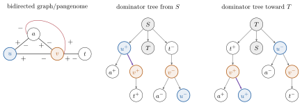

# Dominator bubbles

```bash
BubbleFinder d-bubbles -g graph.gfa -o d-bubbles.txt
BubbleFinder d-bubbles -g graph.gfa -o all-d-bubbles.txt -T
```

To keep only ultrabubbles:

```bash
BubbleFinder ultrabubbles --d-bubbles -g graph.gfa -o ultrabubbles.txt -j 8
```

This uses the same dominator tree and filters the candidate bubbles. `-T` includes trivial ultrabubbles. The tip coverage rule below applies to both commands.

The input is a bidirected GFA or GBZ graph. The command also accepts the existing `-j` option to set the number of workers.

The output starts with the number of bubbles. Each following line gives a bubble with two signed endpoints, for example `a+ b-`. Without `-T`, bubbles without an internal physical vertex are excluded. With `-T`, all computed dominator bubbles are reported.

The algorithm builds a directed graph with two states for each node. It adds a source that reaches the graph through its tips. It then finds the dominator tree of this graph.

For each state `y`, the algorithm looks at its immediate dominator `x`. It keeps the bubble when the reverse of `y` is also the immediate dominator of the reverse of `x`. The tree can also be used to build the hierarchy of these bubbles.

## Example



The endpoints are `u+` and `v-`. The red edge breaks separability. The trees use `v+` for walks entering `v` through `-`.

The figure shows both trees. The code obtains postdominance by reversing signs, using one tree.

The implementation uses the Lengauer Tarjan algorithm. It splits the graph into blocks and shortens simple paths to make the tree faster to compute. It restores the removed states afterwards. The worst case time is `O((|V|+|E|) log(|V|+|E|))`.

The search only covers regions on walks between graph tips. If some nodes are outside those regions, the command prints a warning and reports bubbles in the covered part. An isolated node cannot form a bubble with two different endpoints.
